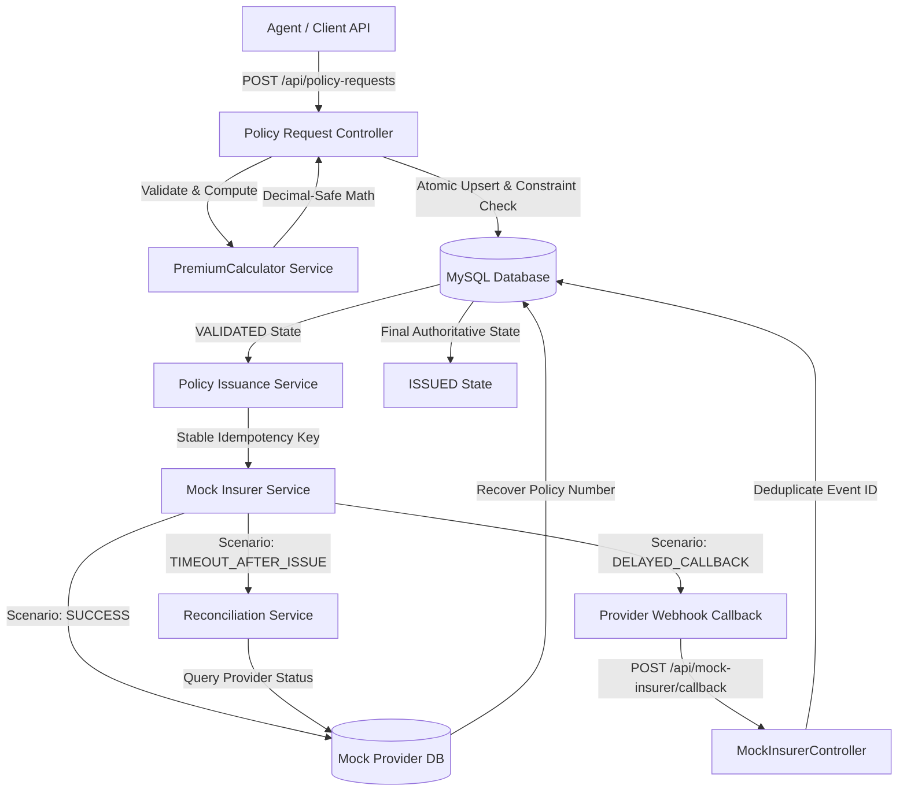

# PolicyFlow — Fault-Tolerant Insurance Issuance & Reconciliation Engine

PolicyFlow is an enterprise-grade travel insurance distributor engine that accepts policy requests from independent travel agents, validates customer and trip parameters, deterministically computes decimal-safe premiums, coordinates issuance with a fictional insurance provider, and safely manages policy states through upstream timeouts, delayed callbacks, and retries.

The primary engineering guarantee of PolicyFlow is:

> **Never create duplicate logical policy requests or issue duplicate policies because an API request, provider submission, callback, or retry is repeated. Never overwrite a confirmed final state with an older or contradictory event.**

---

## 1. Business Problem & Mission

In travel insurance distribution:
1. **Network Drops & Timeouts**: Submitting an issuance to an insurer may time out at the HTTP boundary, but the insurer may have already created the policy and assigned a policy number on their side. Assuming failure causes duplicate policies and double-charging.
2. **Duplicate Callback Webhooks**: Underwriters deliver asynchronous policy approvals via webhooks that can be retried multiple times by network relays.
3. **Concurrent Intake & Retries**: Agents double-click submit buttons, automated systems retry on 5xx errors, or two agents submit concurrent quotes with the same reference.

PolicyFlow implements strict database constraints, row-level locking, stable provider idempotency keys, and an automated reconciliation engine to guarantee exactly-once policy issuance.

---

## 2. Architecture & Flow Diagram



---

## 3. Technology Stack

- **Runtime**: PHP 8.2+ (tested and verified on PHP 8.5)
- **Framework**: Laravel 11+
- **Primary Database**: MySQL 8+ (configured with InnoDB row locking and transactions)
- **Testing Framework**: PHPUnit 11 with Laravel HTTP test suite
- **Financial Precision**: Pure `bcmath` decimal arithmetic (zero binary floating-point drift)
- **Dependency Management**: Composer 2.9+
- **Architecture**: Domain services (`PremiumCalculator`, `PolicyIssuanceService`, `MockInsurerService`, `PolicyReconciliationService`), FormRequests, API Resources, and Blade Operations UI

---

## 4. Implemented Reliability Scenarios

| Scenario | Description | Test Case Name |
| :--- | :--- | :--- |
| **Case 1: Duplicate Intake** | Replaying identical `agent_id` + `client_request_id` returns HTTP 200 without creating duplicate records. Conflicting payload returns HTTP 409 Conflict. | `test_identical_duplicate_intake_returns_200_without_duplication`<br>`test_conflicting_duplicate_intake_returns_409` |
| **Case 2: Timeout After Provider-Side Success** | Submission times out (simulated 504), but provider created policy. Engine prevents blind reissue, executes reconciliation, and recovers the policy number into `ISSUED` state. | `test_reliability_case_2_timeout_after_issue_is_safely_reconciled` |
| **Case 3: Duplicate Callbacks** | Provider delivers identical webhook event multiple times. Deduplicated via unique constraint on `provider_event_id`. Never degrades an `ISSUED` state. | `test_reliability_case_3_duplicate_callbacks_are_deduplicated` |
| **Case 4: Safe Retry After Temporary Failure** | First attempt returns retriable 503. Policy marked `FAILED`. Re-submitting reuses the immutable pricing snapshot and issues successfully on attempt #2. | `test_safe_retry_after_temporary_failure` |

---

## 5. Premium Calculation Engine & Worked Example

Calculated strictly with `bcmath` without binary floating-point rounding errors.

### Multiplier Rules
1. **Base Premium Per Travel Day**:
   - `BASIC` = ₹12.00
   - `PLUS` = ₹20.00
   - `PREMIUM` = ₹30.00
2. **Age Multiplier** (Evaluated as of `trip_start`, not current date):
   - Ages 0–17: `1.10`
   - Ages 18–60: `1.00`
   - Ages 61–70: `1.50`
   - Ages 71+: `2.00`
3. **Destination Multiplier**:
   - `DOMESTIC` = `1.00`
   - `INTERNATIONAL` = `1.80`
4. **Coverage Multiplier**:
   - ₹100,000 Sum Insured = `1.00`
   - ₹300,000 Sum Insured = `1.25`
   - ₹500,000 Sum Insured = `1.50`
5. **Travel Days**:
   $$\text{travel\_days} = (\text{trip\_end} - \text{trip\_start}) + 1\text{ calendar day (minimum 1)}$$

### Canonical Worked Example
- **Plan**: `PLUS` (₹20.00)
- **Trip Dates**: 10 November 2026 to 14 November 2026 (5 days inclusive)
- **Date of Birth**: 10 April 1998 (Age 28 at trip start &rarr; Multiplier `1.00`)
- **Destination**: `INTERNATIONAL` (Multiplier `1.80`)
- **Sum Insured**: ₹300,000 (Multiplier `1.25`)

$$\text{Premium} = 20.00 \times 5 \times 1.00 \times 1.80 \times 1.25 = \mathbf{₹225.00}$$

The result is saved as a `DECIMAL(10,2)` pricing snapshot and becomes immutable.

---

## 6. Policy State Lifecycle

The system enforces centralized transition validation (`PolicyStatus::canTransitionTo()`):

```
       [RECEIVED]
           │
           ▼
      [VALIDATED] ──(pricing snapshot saved)
           │
           ▼
      [SUBMITTED] ──(lock acquired, attempt logged)
      /    │    \
     /     │     \
    ▼      ▼      ▼
[ISSUED] [PENDING] [NEEDS_RECONCILIATION]
   ▲       │              │
   │       ▼              ▼
   └─ [CALLBACK] ── [RECONCILIATION]
           ▲
           │ (Safe Retry)
        [FAILED]
```

- **`ISSUED` is strictly terminal**: Once a policy reaches `ISSUED`, no repeated request, stale webhook, or contradictory rejection can ever downgrade or modify it.
- **Append-only audit trail**: Every status change writes an entry to `policy_state_histories` with `previous_status`, `new_status`, `source`, and timestamp.

---

## 7. Local Setup Instructions

### Prerequisites
- PHP 8.2 or newer with extensions: `bcmath`, `pdo_mysql`, `curl`, `mbstring`
- Composer 2.x
- MySQL 8.0+ running on `127.0.0.1:3306`

### Step 1: Clone and Enter Repository
```bash
git clone https://github.com/your-username/policyflow-<your-candidate-id>.git
cd policyflow-<your-candidate-id>
```

### Step 2: Install Composer Dependencies
```bash
composer install --no-interaction
```

### Step 3: Configure Environment
Copy the example configuration:
```bash
cp .env.example .env
php artisan key:generate
```

Verify your MySQL connection details in `.env`:
```ini
DB_CONNECTION=mysql
DB_HOST=127.0.0.1
DB_PORT=3306
DB_DATABASE=policyflow
DB_USERNAME=root
DB_PASSWORD=
```

### Step 4: Create MySQL Databases
Log into your MySQL client and create the primary and testing databases:
```sql
CREATE DATABASE IF NOT EXISTS policyflow;
CREATE DATABASE IF NOT EXISTS policyflow_test;
```

### Step 5: Run Database Migrations & Seed Data
```bash
php artisan migrate
php artisan db:seed
```
*Note: Seeding populates realistic demonstration policies in various lifecycle states (`VALIDATED`, `ISSUED`, `PENDING_CONFIRMATION`, `FAILED`).*

### Step 6: Start Local Server
```bash
php artisan serve
```
The application will be running on **`http://127.0.0.1:8000`**.

---

## 8. Running Automated Tests

Run the full automated test suite against the local MySQL testing database:

```bash
php artisan test
```

To run individual test suites:
```bash
# Unit Tests (Premium calculation formula, age boundaries, rounding)
php artisan test --filter=PremiumCalculatorTest

# Feature Tests (Intake validation, idempotency, conflicts, listing)
php artisan test --filter=PolicyIntakeTest

# Reliability Tests (Timeout recovery, duplicate callbacks, retries)
php artisan test --filter=PolicyIssuanceAndReliabilityTest

# Minimal Operations UI Tests
php artisan test --filter=OperationsDashboardTest
```

---

## 9. API Endpoint Reference

| Method | URI | Description |
| :--- | :--- | :--- |
| `POST` | `/api/policy-requests` | Validate and accept policy request with compound unique idempotency (`agent_id` + `client_request_id`). |
| `GET` | `/api/policy-requests/{id}` | Retrieve request details, pricing snapshot, and append-only state transition audit trail. |
| `GET` | `/api/policy-requests` | Paginated listing supporting `?status=ISSUED&per_page=15`. |
| `POST` | `/api/policy-requests/{id}/submit` | Initiate issuance or resume recovery. Supports simulation headers like `X-Mock-Scenario: TIMEOUT_AFTER_ISSUE`. |
| `POST` | `/api/policy-requests/{id}/reconcile` | Query provider to authoritatively reconcile uncertain outcomes. |
| `POST` | `/api/mock-insurer/callback` | Deduplicated callback webhook receiver. |
| `GET` | `/api/mock-insurer/policies/{identifier}` | Provider status lookup endpoint. |
| `GET` | `/` | Web operations dashboard for visual inspection and testing. |

Detailed curl examples for every scenario are available in [examples/curl-commands.md](examples/curl-commands.md).

---

## 10. Concurrency & Idempotency Strategy

1. **Intake Concurrency**:
   - Compounded database unique constraint `UNIQUE (agent_id, client_request_id)`.
   - Simultaneous concurrent requests are serialized by InnoDB. The first insert succeeds (`201 Created`); the loser encounters a unique key collision (SQLSTATE 23000), which is caught to safely return the existing logical request (`200 OK`) if payloads match, or `409 Conflict` if data differs.
2. **Issuance Concurrency**:
   - Short database transaction with `PolicyRequest::lockForUpdate()`.
   - Submissions increment `attempt_count` and write an `IN_PROGRESS` attempt row before releasing the database lock.
   - HTTP communication with the mock insurer occurs **outside** the database transaction, preventing network stalls from exhausting connection pools.
3. **Provider Idempotency**:
   - The provider receives a stable idempotency key formatted as `IDEM-POL-{uuid}`.
   - Retries reuse this key, ensuring the insurer never issues two policy numbers for the same logical policy.
4. **Callback Deduplication**:
   - Database unique constraint on `provider_event_id`.
   - Repeated webhook deliveries are safely acknowledged with `DUPLICATE_EVENT_IGNORED` without mutating policy records.

---

## 11. Minimal Operations UI

A clean Blade-based operator interface is included at `http://127.0.0.1:8000`:
- **Dashboard**: Metrics summary cards, searchable policy table, and status filters.
- **Inspect View**: Visual breakdown of the pricing formula snapshot, issuance attempt logs, and append-only state timeline.
- **Operator Simulation Controls**: Dropdown to test `SUCCESS`, `TIMEOUT_AFTER_ISSUE`, `TEMPORARY_FAILURE`, or `DELAYED_CALLBACK` with a single click.

---

## 12. Design Assumptions & Limitations

1. **Local Simulation**: All customer and provider data is fabricated. No real payment gateways or third-party APIs are called.
2. **Synchronous Core**: Processing is synchronous for maximum deterministic simplicity, as permitted by the specification. Queues are not required for local evaluation.
3. **Scenario Headers**: The `X-Mock-Scenario` header is strictly for local simulation/evaluation and should be disabled in production.

---

## 13. GitHub Submission Steps

To submit this project:
```bash
# 1. Create a repository named policyflow-<your-candidate-id> on GitHub
# 2. Add remote and push
git remote add origin https://github.com/<your-github-username>/policyflow-<your-candidate-id>.git
git branch -M main
git push -u origin main
```
